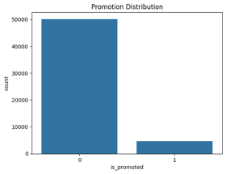
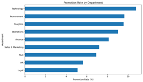
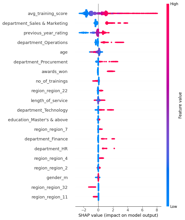
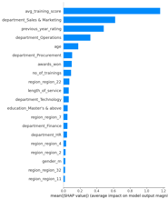
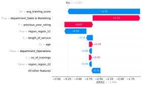

# Employee Promotion Prediction

An end-to-end machine learning project that analyzes employee data and predicts historical promotion outcomes using Python and XGBoost.

## Project Overview

Organizations need reliable ways to understand workforce patterns and evaluate promotion processes. This project explores whether historical employee data can be used to identify patterns associated with promotion outcomes.

The project covers data preparation, exploratory data analysis, feature engineering, model development, evaluation, threshold optimization, and model explainability.

**Important:** This is a portfolio and analytical research project. Predictions should not be used as the sole basis for employment or promotion decisions.

## Business Problem

Can historical employee data help identify patterns associated with promotion outcomes, and how effectively can a classification model distinguish between employees who were and were not promoted?

The objective is to evaluate predictive performance and identify limitations, not to automate employment decisions.

## Dataset

- Number of records: 54,808
- Target variable: `is_promoted`
- Problem type: Binary classification
- Data source: Document the original dataset provider and link here.
- Data limitations: Document missing values, class imbalance, data coverage, and any relevant privacy or fairness concerns.

## Analytical Workflow

1. Business understanding and problem definition
2. Data quality assessment and exploratory data analysis
3. Data preparation and feature engineering
4. Train/validation/test strategy
5. Model development and comparison
6. Hyperparameter tuning and cross-validation
7. Classification threshold optimization
8. Model evaluation and explainability
9. Streamlit application and prediction demonstration
10. Limitations and recommendations

## Model and Results

The project uses XGBoost for binary classification.

Reported results from the project include:

| Metric | Result |
|---|---:|
| Tuned ROC-AUC | 0.8222 |
| Mean cross-validation ROC-AUC | 0.8197 |
| Selected classification threshold | 0.2506 |
| F1-score at selected threshold | 0.526 |

These values should be interpreted alongside precision, recall, the confusion matrix, and the evaluation split on which each result was obtained.

The selected threshold is specific to the model and evaluation procedure. It should not be assumed to be optimal for every business objective.

## Model Interpretation

Use feature importance and SHAP analysis, where implemented, to investigate which variables influence model predictions.

Feature associations do not establish causation. Before any real-world workforce application, the model would require appropriate fairness testing, privacy safeguards, human oversight, and validation on representative data.

## Repository Contents

- `*.ipynb` — exploratory analysis, model development, and evaluation
- `app.py` — Streamlit application
- `requirements.txt` — Python dependencies
- Model artifacts — serialized model or preprocessing objects, if required by the application

Update this section to match the actual filenames in the repository.

## Run Locally

1. Clone the repository:

   `git clone https://github.com/NematullahAmiri/employee-promotion-prediction.git`

2. Enter the project directory:

   `cd employee-promotion-prediction`

3. Create and activate a virtual environment.

4. Install the dependencies:

   `pip install -r requirements.txt`

5. Start the application:

   `streamlit run app.py`

Confirm that these steps work in a clean environment before publishing them.

## Key Findings

Summarize three to five findings that are actually supported by your analysis. Explain the practical meaning of each finding and distinguish descriptive associations from causal conclusions.

## Limitations and Future Improvements

- Evaluate fairness across relevant employee groups where the data and legal context permit.
- Validate the pipeline against data leakage and inconsistent preprocessing.
- Report precision, recall, F1-score, and confusion-matrix results at the selected threshold.
- Test model stability and generalization on suitable held-out data.
- Add automated tests and model monitoring where appropriate.
- Keep human judgment central to any employment-related decisions.

## Skills Demonstrated

Python · Pandas · NumPy · Scikit-learn · XGBoost · Classification · Model Evaluation · Threshold Optimization · Explainable AI · Streamlit

Remove tools or techniques that were not actually used.

## Exploratory Data Analysis

### Promotion Distribution

This chart examines the distribution of employee promotion outcomes and helps assess whether the target variable is imbalanced. Understanding the distribution is important when selecting evaluation metrics and developing a suitable classification strategy.

### Promotion Rates by Department
This comparison explores differences in promotion rates across departments. These patterns can guide further investigation into promotion processes, while recognizing that differences alone do not establish unfair treatment or identify their causes.

## Model Explainability

### SHAP Summary Plot
The SHAP summary plot shows how model features contribute to predictions across the dataset. It helps examine which features influence predictions and whether their values tend to increase or decrease the model's output.

### SHAP Feature Importance
This chart ranks features by their overall contribution to model predictions. The results can help identify the strongest predictive signals, but model importance should not be interpreted as proof of causation.

### Individual Prediction Explanation
Keep these descriptions only if they accurately match the charts you uploaded. Later, replace general wording with your actual findings—for example, which department has the highest promotion rate or which features are most influential.

## Author

Nematullah Amiri

Portfolio: https://nematullahamiri.github.io/

GitHub: https://github.com/NematullahAmiri
